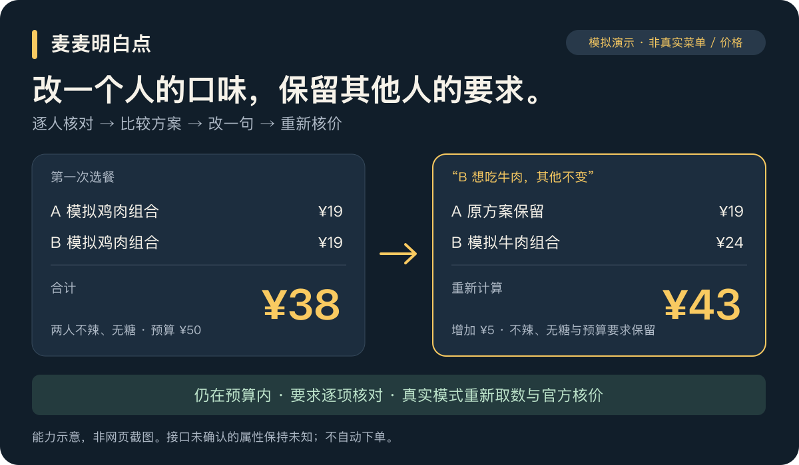

# 麦麦明白点 · meal-clear

**两个人点餐，改一个人的要求，不必从头再来。**

一个到店自取选餐 Skill：逐人检查要求、比较预算内方案；你说“B 换牛肉，其他不变”，它保留 A 的要求和预算，重新选餐、重新核价，并说明价格为什么变了。

Python 3.9+ · 零运行依赖 · 支持离线演示 · 真实接口只读



> 上图是能力示意，**不是网页界面**。商品和价格全部为模拟数据；真实模式以当次官方核价为准。

[立即体验](#一分钟体验) · [它能帮什么](#三个值得用它的时刻) · [真实验证](#真实模式跑通过吗) · [使用指南](docs/使用与接入.md)

## 三个值得用它的时刻

| 你的处境 | 麦麦明白点怎么处理 | 你能看见什么 |
| --- | --- | --- |
| 两个人口味不同，还要控制总预算 | 逐人核对硬要求，在有限候选中比较价格与偏好 | 每个人吃什么、总价多少、要求是否满足 |
| 已经选好了，有人临时想换牛肉 | 只修改明确提出的要求，保留其他条件；真实模式重新取数核价 | 哪个人的餐变了、价格差多少、是否仍在预算内 |
| 推荐看起来不错，但不知道是否可靠 | 对每项硬要求区分“已核实／冲突／未知” | 哪些有依据，哪些还不能确认 |

**最重要的原则：不知道，就明确说不知道。** 例如菜单没有说明辣度，就不能凭名称不带“辣”确认不辣；没有可确认的方案时，不会偷偷放宽预算或删掉要求。

## 看一次“改一句”

下面是内置演示的任务与结果摘要，**商品、属性和价格均为虚构测试数据**：

> **你：** 两个人，预算 50 元，都要不辣、无糖饮料，优先鸡肉。
>
> **结果：** A 模拟鸡肉组合 19 元；B 模拟鸡肉组合 19 元。合计 **38 元**，要求已核对。
>
> **你：** B 想吃牛肉，其他不变。
>
> **更新：** A 保持原方案；B 换模拟牛肉组合 24 元。合计 **43 元，增加 5 元**，仍在 50 元内。两人的不辣、无糖要求继续保留。

在真实模式中，同样的修改会触发新的菜单查询与官方核价。旧报价不会被拿来当作新结果。

[查看程序完整演示输出](examples/demo-output.md) · [查看请求与修改格式](references/data-contract.md)

## 一分钟体验

准备 Python 3.9+。如果已经下载项目，直接运行最后一行；下载完成后的演示不联网、不需要 Token，也不用安装依赖。

```sh
git clone https://github.com/brucezhao-finance/meal-clear.git
cd meal-clear
python3 scripts/meal_clear.py demo
```

仓库当前为私有，克隆需要仓库访问权限。你会看到 **38 元 → 43 元** 的两次模拟方案，以及只修改 B 的差异记录。这是本地程序可复现的结果。

## 在 Agent 中使用

让支持本地 Skill 的 Agent 读取本项目的 [SKILL.md](SKILL.md)，例如：

> 读取这个项目的 SKILL.md，使用“麦麦明白点”。先用内置模拟数据演示两人选餐，再把 B 的主食要求改成牛肉，其他要求不变，解释差价。

也可以把**整个 `meal-clear` 目录**安装到目标 Agent 支持的 Skill 位置，保留 `scripts`、`references`、`examples` 的相对路径。可分发包见 [meal-clear.skill](dist/meal-clear.skill)。

Agent 负责理解自然语言，Python 程序负责约束、组合与金额计算。本项目提供 Skill 和配套命令行程序。

需要真实菜单时，先配置 `MCD_MCP_TOKEN` 环境变量或已有的本地 Token 文件，确认自己的门店，再运行真实模式。**不要把 Token 发到对话或提交到仓库。** [查看接入步骤、完整命令与故障说明 →](docs/使用与接入.md)

## 真实模式跑通过吗？

**跑通过只读选餐与修改后核价。** 以下是 2026-10-17 上海静安寺工程测试门店（1450002）的历史记录，均未下单；不代表当前价格，也不是你的默认门店。

| 当次请求 | 官方核价结果 |
| --- | --- |
| 单人、无糖饮品、预算 100 元 | Hold不住鸡排堡（椒盐风味）＋中薯条＋无糖可口可乐中杯：**22.90 元** |
| 增加牛肉要求，保留无糖、预算与门店 | 不素之霸双层牛堡＋中薯条＋无糖可口可乐中杯：**38.00 元** |
| 修改后的变化 | 重新取数并核价，**增加 15.10 元**，未复用旧报价 |

当次成功发现 35 个官方工具、读取 126 个菜单条目。门店券查询返回 **0 张**，**当次未验证有券参与的真实算价**。

**2026-10-19 补充验收：** 早餐单人无糖组合官方核价 **12.40 元**，两人合计 **24.80 元**；从原会话增加无糖要求后重新核价，差价 **+2.50 元**。本次还验证了一张当前券参与官方算价，未领券、核销或下单。发现并修复了早餐“组合”漏选和损坏菜单输入报错两类问题。[查看实际测试报告与完整过程](verification/2026-10-19-acceptance/测试报告.md)。以上均为对应日期、门店和账户的历史报价。

**同日全量验收：** 81 个自动测试方法、429 个数据子用例通过；65 个程序测试点和 35 个函数均有执行证据。核心、CLI、实时适配器行与分支覆盖均为 100%，协议模块保留一处不可达的防御兜底。另完成上海/北京两店真实只读验证、跨早餐至正餐重算、真实 401 停止和当前 28 个非白名单工具阻断检查。[全量报告与逐点覆盖矩阵](verification/2026-10-19-full/全量测试报告.md)。

[真实联调记录](verification/真实联调记录.md) · [结构化验证摘要](verification/live-validation.json)

## 能力与边界

| 项目 | 当前状态 |
| --- | --- |
| 两人逐人约束、预算比较、修改后差异计算 | 已实现；同门店、同时间、到店自取，最多 2 人 |
| 真实菜单、无糖饮品替换、官方核价 | 已接入；只处理接口明确支持的套餐与选项 |
| 门店券 | 能查询并有限尝试券商品；已验证单张当前券参与官方算价，未验证核销或多券 |
| 会员卡回本 | 支持给定卡费与每次节省额的计算；尚未接入实时卡权益 |
| 下单、领券、支付、积分兑换、取消 | 客户端拒绝调用相关写工具 |

首版仅比较已检查的有限候选，**不承诺全网最低价**。暂不支持外送、任意去冰去酱或自动长期口味记忆；无法保证过敏安全。真实菜单缺少的属性保持未知。[完整限制与常见问题](docs/使用与接入.md#常见问题)

## 验证与维护

```sh
python3 -m unittest discover -s tests -v
```

**81 项离线测试**覆盖金额精度、卡费、未知约束、双人修改、换店报价失效、官方费用矛盾、协议解析、文件安全与写工具拒绝。测试不需要网络和真实账户，已在 Python 3.9.6 和 3.13.9 执行。另保留早期验收的 [27 项命令行场景与 5 项故障测试](verification/2026-10-19-acceptance/完整测试过程.md)。

全量复现入口是 `python3 verification/2026-10-19-full/run_full.py`；可选分支覆盖及 8 个关键缺陷变异验证见[报告中的复现说明](verification/2026-10-19-full/全量测试报告.md#6-复现)。全量清单不等于所有账户、门店、模型或未来输入永不失败，外部验证边界逐项列在报告中。

[开发与接入指南](docs/使用与接入.md) · [验收场景](references/evaluation-cases.md) · [项目规则](AGENTS.md)

麦麦明白点是使用麦当劳 MCP 的独立项目，非麦当劳官方产品。
