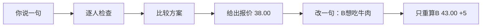

# 麦麦明白点 meal-clear

**麦麦点餐，改一句就明白。**

> **“麦麦” = 大家对麦当劳（McDonald's）的昵称。** 两个人到店自取、要求各不同、预算有限，这个 Skill 帮你逐人核对，改一句也只重算该改的部分。


体验（零依赖、免 Token、不联网）：`python3 scripts/meal_clear.py demo`

> 图中商品与价格均为**模拟数据**。**非麦当劳官方产品，参赛作品。**

## 3 步用起来

| 步骤 | 你做什么 |
| --- | --- |
| 1 | 下载项目，运行 `python3 scripts/meal_clear.py demo` |
| 2 | 让支持本地 Skill 的 Agent 读取 [SKILL.md](SKILL.md) |
| 3 | 说出每人的要求和预算，看结果：谁吃什么、总价、已核实／冲突／未知 |


<details>
<summary>文字版流程（Mermaid）</summary>



</details>

可以这样对 Agent 说：

> 读取这个项目的 SKILL.md，使用“麦麦明白点”。先用内置模拟数据演示两人选餐，再把 B 的主食要求改成牛肉，其他要求不变，解释差价。

## 改一句，不重来


只改 B，其他条件（不辣、无糖、预算）保留；旧报价不会被当作新结果。

## 它不会做什么


不知道，就明确说不知道。仅比较已检查的有限候选。

## 安装与依赖

- Python ≥ 3.9，**零运行依赖**。
- 把整个 `meal-clear` 目录放进 Agent 的 Skill 位置，或使用发布包 `dist/meal-clear.skill`（由 `python3 scripts/build_skill.py` 生成）。
- 真实菜单模式需自行配置凭证，详见 [使用与接入](docs/使用与接入.md)。

## 目录

| 路径 | 说明 |
| --- | --- |
| `SKILL.md` | Skill 入口 |
| `scripts/` | 命令行程序与打包脚本 |
| `references/` · `examples/` | 数据格式、验收场景、模拟数据 |
| `docs/` | 使用指南、[真实验证与能力边界](docs/真实验证与能力边界.md)、配图 |
| `tests/` | 离线回归测试 |

## 合规与文档

[参赛声明](CONTEST_DECLARATION.md) · [MCP 接入说明](MCP_INTEGRATION.md) · [MCP 配置示例](mcp-config.example.json) · [LICENSE](LICENSE) · [真实验证与能力边界](docs/真实验证与能力边界.md)

**同日全量验收（作者本地报告记录，未经第三方复核）：** 自动测试方法与数据子用例、测试点和函数覆盖、两店真实只读验证、跨早餐至正餐重算、真实 401 停止和非白名单工具阻断检查的具体数字与口径见[全量报告与逐点覆盖矩阵](https://github.com/brucezhao-finance/meal-clear/blob/main/verification/2026-10-19-full/全量测试报告.md)。

[真实联调记录](https://github.com/brucezhao-finance/meal-clear/blob/main/verification/真实联调记录.md) · [结构化验证摘要](https://github.com/brucezhao-finance/meal-clear/blob/main/verification/live-validation.json)

## 能力与边界

| 项目 | 当前状态 |
| --- | --- |
| 两人逐人约束、预算比较、修改后差异计算 | 已实现；同门店、同时间、到店自取，最多 2 人 |
| 真实菜单、无糖饮品替换、官方核价 | 已接入；只处理接口明确支持的套餐与选项 |
| 门店券 | 能查询并有限尝试券商品；已验证单张当前券参与官方算价，未验证核销或多券 |
| 会员卡回本 | 支持给定卡费与每次节省额的计算；尚未接入实时卡权益 |
| 下单、领券、支付、积分兑换、取消 | 客户端拒绝调用相关写工具 |

首版仅比较已检查的有限候选，**不承诺全网最低价**。暂不支持外送、任意去冰去酱或自动长期口味记忆；无法保证过敏安全。真实菜单缺少的属性保持未知。[完整限制与常见问题](docs/使用与接入.md#常见问题)

## 验证与维护

```sh
python3 -m unittest discover -s tests -v
```

**87 项离线测试**覆盖金额精度、卡费、未知约束、双人修改、换店报价失效、官方费用矛盾、协议解析、文件安全与写工具拒绝。测试不需要网络和真实账户。另有本次验收的 [27 项命令行场景与 5 项故障测试](https://github.com/brucezhao-finance/meal-clear/blob/main/verification/2026-10-19-acceptance/完整测试过程.md)。

全量复现入口是 `python3 verification/2026-10-19-full/run_full.py`，其中可能包含联网真实只读步骤，运行前请先阅读脚本；全量清单不等于所有账户、门店、模型或未来输入永不失败，外部验证边界逐项列在[报告](https://github.com/brucezhao-finance/meal-clear/blob/main/verification/2026-10-19-full/全量测试报告.md)中。

[开发与接入指南](docs/使用与接入.md) · [验收场景](references/evaluation-cases.md) · [项目规则](AGENTS.md)

## 免责声明

麦麦明白点是使用麦当劳 MCP 的独立项目，**非麦当劳官方产品**，为参赛作品。示例价格均为模拟数据，真实价格以官方当次核价为准；不构成医疗营养建议。
