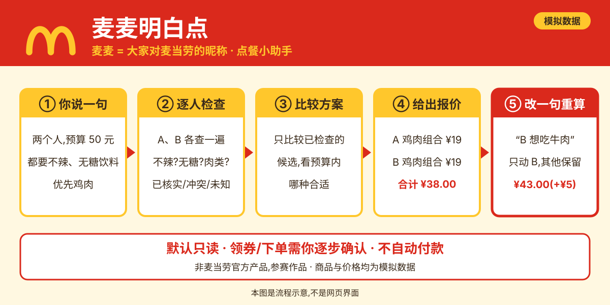
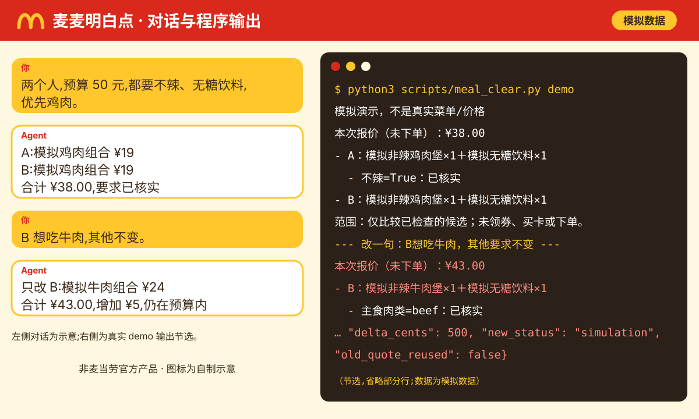
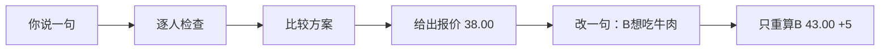
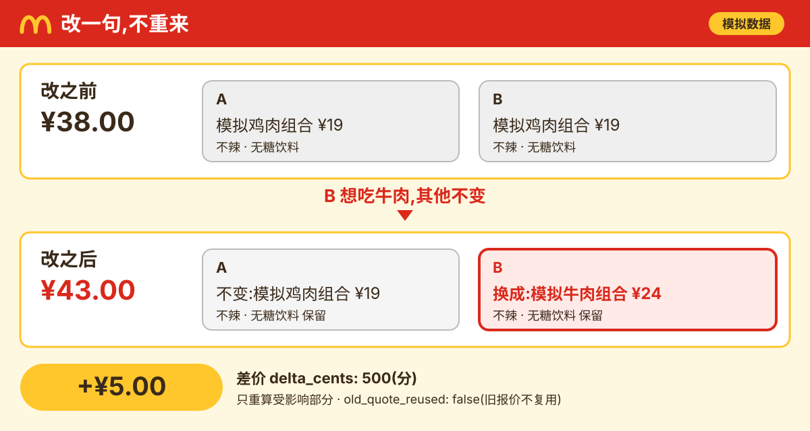
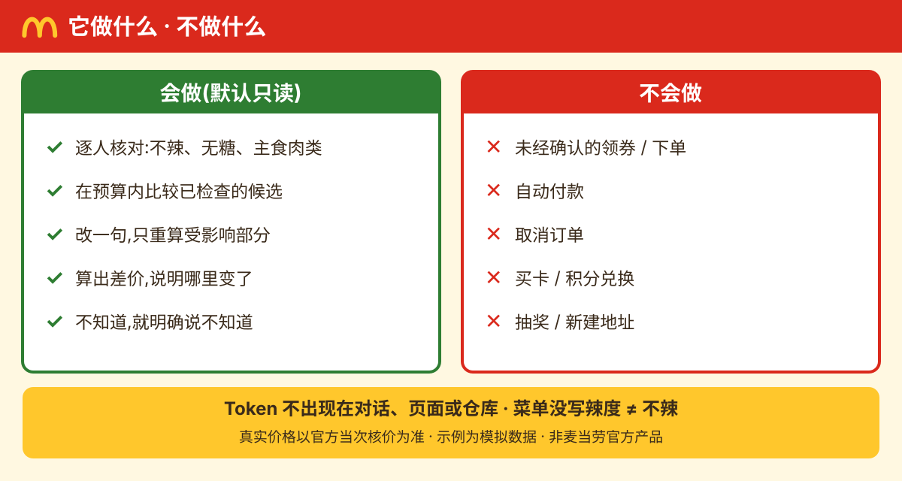

# 麦麦明白点 meal-clear

**麦麦点餐，改一句就明白。**

> **“麦麦” = 大家对麦当劳（McDonald's）的昵称。** 两个人到店自取、要求各不同、预算有限，这个 Skill 帮你逐人核对，改一句也只重算该改的部分。

体验（零依赖、免 Token、不联网）：`python3 scripts/meal_clear.py demo`

> 图中商品与价格均为**模拟数据**。**非麦当劳官方产品，参赛作品。**

## 3 步用起来

| 步骤 | 你做什么 |
| --- | --- |
| 1 | 下载项目，运行 `python3 scripts/meal_clear.py demo` |
| 2 | 让支持本地 Skill 的 Agent 读取 [SKILL.md](SKILL.md) |
| 3 | 说出每人的要求和预算，看结果：谁吃什么、总价、已核实／冲突／未知 |

文字版流程（Mermaid）

可以这样对 Agent 说：

> 读取这个项目的 SKILL.md，使用“麦麦明白点”。先用内置模拟数据演示两人选餐，再把 B 的主食要求改成牛肉，其他要求不变，解释差价。

## 改一句，不重来

只改 B，其他条件（不辣、无糖、预算）保留；旧报价不会被当作新结果。

## 它不会做什么

不知道，就明确说不知道。仅比较已检查的有限候选。

## 安装与依赖

- Python ≥ 3.9，**零运行依赖**。
- 把整个 `meal-clear` 目录放进 Agent 的 Skill 位置，或使用发布包 `dist/meal-clear.skill`（由 `python3 scripts/build_skill.py` 生成）。
- 真实菜单模式需自行配置凭证，详见 [使用与接入](docs/使用与接入.md)。

## 目录

| 路径 | 说明 |
| --- | --- |
| `SKILL.md` | Skill 入口 |
| `scripts/` | 命令行程序与打包脚本 |
| `references/` · `examples/` | 数据格式、验收场景、模拟数据 |
| `docs/` | 使用指南、[真实验证与能力边界](docs/真实验证与能力边界.md)、配图 |
| `tests/` | 离线回归测试 |

## 合规与文档

[参赛声明](CONTEST_DECLARATION.md) · [MCP 接入说明](MCP_INTEGRATION.md) · [MCP 配置示例](mcp-config.example.json) · [LICENSE](LICENSE) · [真实验证与能力边界](docs/真实验证与能力边界.md)

## 免责声明

麦麦明白点是使用麦当劳 MCP 的独立项目，**非麦当劳官方产品**，为参赛作品。示例价格均为模拟数据，真实价格以官方当次核价为准；不构成医疗营养建议。
